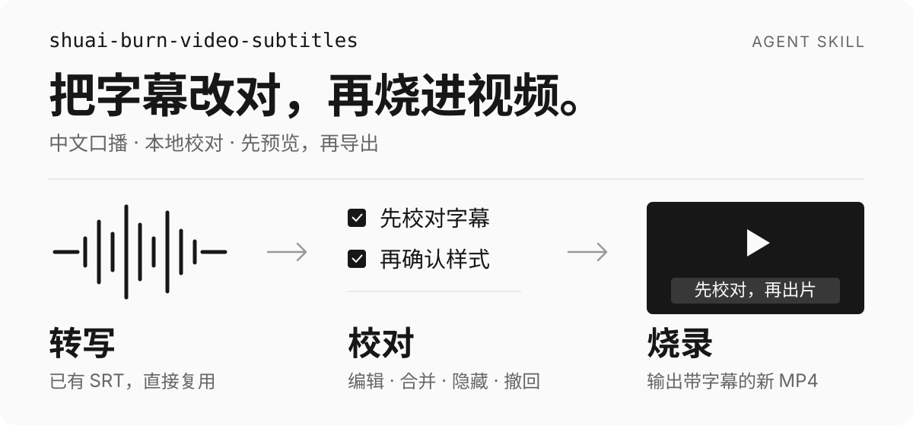

<p align="center">
  
</p>

<h1 align="center">shuai-burn-video-subtitles</h1>

<p align="center">
  有视频，就能做字幕。<br>
  从自动转写、AI 校对到带字幕的成片，支持 macOS 与 Windows。
</p>

## 快速开始

使用 [Agent Skills CLI](https://skills.sh/docs/cli) 安装：

```bash
npx skills add qizong007/shuai-burn-video-subtitles
```

安装内容仅包含 Skill 运行所需的说明、元数据、脚本和校对页，不包含 README 与展示图片。

CLI 会让你选择目标 Agent 和安装范围。安装完成后，提供本地视频路径并调用：

```text
使用 $shuai-burn-video-subtitles，给这段中文口播视频加字幕。
自动识别语音、校对文字，再打开网页让我审核。
审核完成后做一段字幕样式预览，确认后再输出完整视频。
```

只处理已有字幕也可以：

```text
使用 $shuai-burn-video-subtitles，打开这个视频和 SRT 的校对页。
本次只校对并同步字幕。
```

## 它解决什么

自动转写之后，字幕往往还需要修正人名、技术术语、断句和错字。直接烧进视频，通常要等导出完成后才能发现问题，再改一遍、导出一遍。

`shuai-burn-video-subtitles` 把这几步串成一套可审核的流程：

- **只需提供视频**：自动提取音频、识别语音并生成字幕，无需提前准备 SRT。
- **AI 先校对一遍**：结合音视频和项目资料修正错字、人名与术语。
- **边看边改**：点击字幕跳到画面，双击编辑，支持合并、隐藏和操作撤回。
- **确认后再出片**：先检查文字和短片样式，再导出完整视频。
- **成片与文稿一起交付**：带字幕的视频、SRT、带时间戳文稿和纯文本分别保存，保留原件。

有现成 SRT 时也可直接校对或烧录，跳过转写。

## 支持的操作

校对页顶部显示 shuai 字标、工具名与主题切换，左侧播放视频，右侧用单条工具栏管理字幕。点击字幕即可定位到对应画面；选中字幕后显示批量操作。

| 操作 | 用法 |
| --- | --- |
| 定位与编辑 | 单击跳转；双击文字或点击铅笔编辑，Enter 提交，Escape 取消 |
| 多选与合并 | 勾选行首复选框；连续选中两条以上可见字幕后，点击「合并」 |
| 隐藏与恢复 | 点击眼睛切换显隐；多选后可批量隐藏，保存后重开仍可恢复 |
| 查找替换 | 点击「查找」或按 `Cmd/Ctrl+F`，Escape 关闭 |
| 撤回与重做 | `Cmd/Ctrl+Z` 撤回，`Cmd/Ctrl+Y` 重做，最多保留 50 步 |
| 深浅主题 | 默认按本机时间切换；点击太阳／月亮手动切换，右键恢复自动 |

合并会使用第一条的开始时间、最后一条的结束时间，并按顺序连接文字。非连续选择或包含隐藏项时，无法合并。

自动主题在 07:00–19:00 使用浅色，其余时间使用深色。撤回历史在刷新后清空；输入框内使用浏览器原生文字撤回。完整说明见 [校对页说明](./skills/shuai-burn-video-subtitles/references/preview-editor.md)。

## 工作流程

```text
提供视频 → 自动转写 → AI 校对 → 网页审核
         → 同步字幕与文稿 → 短片预览 → 导出带字幕的视频
```

默认字幕使用白色略粗字体、贴合文字的半透明深色圆角背景，底部居中。字号和边距随视频尺寸调整，超宽文字自动换行。网页的深浅主题只影响校对界面。

<details>
<summary>独立运行校对页与同步命令</summary>

以下为 macOS / POSIX 命令。Windows 请使用 [PowerShell 示例](./skills/shuai-burn-video-subtitles/references/environment.md#windows-powershell)。请替换实际文件路径：

```bash
git clone https://github.com/qizong007/shuai-burn-video-subtitles.git
cd shuai-burn-video-subtitles
SKILL="$PWD/skills/shuai-burn-video-subtitles"

python3 "$SKILL/scripts/preview_editor.py" \
  --video /path/to/input.mp4 \
  --srt /path/to/input_polished.srt \
  --work-dir /path/to/input.subtitle-work
```

打开终端打印的本地 URL，通常为 `http://127.0.0.1:8765/`；端口被占用时会选择后续可用端口。关闭终端或中断进程会停止服务。重新审核时沿用同一工作目录；`--reset` 会重建工作记录。

点击「保存并关闭」后，运行以下命令同步字幕和文稿：

```bash
python3 "$SKILL/scripts/sync_review.py" \
  --work-dir /path/to/input.subtitle-work \
  --srt /path/to/input_polished.srt

python3 "$SKILL/scripts/write_transcript_views.py" \
  --srt /path/to/input_polished.srt --force
```

转写、样式预览和烧录命令见 [SKILL.md](./skills/shuai-burn-video-subtitles/SKILL.md)。

</details>

## 输出约定

默认输出放在视频所在目录，按执行步骤逐步生成：

```text
视频所在目录/
├── input.mp4                       # 源视频，保留
├── input.srt                       # 原始字幕，保留
├── input_polished.srt              # 校对字幕，后续同步会更新覆盖
├── input_polished_timestamped.txt  # 带时间戳文稿
├── input_polished_clean.txt        # 纯文本
├── input.subtitle-work/            # 校对记录、原始快照与预览资源
├── input_subtitle_preview.mp4      # 字幕样式预览
└── input_subtitled.mp4              # 带字幕的完整视频
```

**「保存并关闭」只保存校对记录；SRT 同步和视频导出由后续步骤完成。**

| 步骤 | 文件变化 |
| --- | --- |
| 保存并关闭 | 在工作目录写入或覆盖 `subtitle-transcript.json`、`manual-edit-review.json` 和 `preview-saved.json` |
| 同步字幕 | `sync_review.py` 将可见字幕写入 `--srt` 指定的文件；正常流程更新 `input_polished.srt` |
| 更新文稿 | 根据校对 SRT 更新带时间戳和纯文本两份 TXT |
| 预览与烧录 | 分别生成短片预览和带字幕的新 MP4 |

隐藏的字幕仍保留在工作 JSON 中，可在重开校对页后恢复。同步会覆盖指定 SRT，须使用校对副本路径；原始 `input.srt` 保留。

保存成功后会清除浏览器草稿，并尝试关闭页面；浏览器阻止关闭时保留成功提示，本地服务继续运行。

## 环境与能力边界

这是一套由 Agent 执行的字幕工作流，附带可独立运行的脚本。文字校对由 Agent 完成，转写和烧录使用本地工具。

- **运行环境**：Python 3.10+；网页校对与 SRT 同步只使用标准库。
- **语音转写**：需要 `uv`、faster-whisper 和 OpenCC，首次使用会下载模型。
- **字幕烧录**：需要 FFmpeg、ffprobe、Pillow，以及 FFmpeg 的 libass / `ass` 滤镜。配置见 [macOS / Windows 环境说明](./skills/shuai-burn-video-subtitles/references/environment.md)。
- **平台支持**：macOS 默认使用 `Hiragino Sans GB`；Windows 自动寻找微软雅黑或黑体，也可通过 `--font-file` 指定中文字体。字幕布局规则一致，字形随字体变化。
- **文字验收**：人名、术语和含混发音仍需对照原视频检查；完整烧录前先审核文字与短片样式。
- **默认标点**：保留句内逗号，移除句尾标点，仅允许句尾省略号和感叹号；具体规则见 [SKILL.md](./skills/shuai-burn-video-subtitles/SKILL.md)。

## 项目结构

```text
shuai-burn-video-subtitles/
├── README.md                           # 中文文档
├── assets/readme/                      # README 视觉素材，不随 Skill 安装
└── skills/shuai-burn-video-subtitles/
    ├── SKILL.md                        # 工作流、默认值与验收标准
    ├── agents/openai.yaml              # Skill 展示元数据
    ├── assets/preview.html             # 网页校对界面
    ├── assets/brand/                   # shuai 字标，使用已确认的 ai 下划线版
    ├── references/                     # 校对与环境说明
    └── scripts/                        # 转写、同步、文稿与烧录脚本
```

## 维护与贡献

这是一个长期维护的 Agent Skill。提交变更时请遵守：

- 以 [`SKILL.md`](./skills/shuai-burn-video-subtitles/SKILL.md) 为工作流、默认值和验收标准的依据，并与脚本行为保持一致。
- 修改校对页时，同时核对定位、编辑、合并、显隐、撤回与保存行为。
- 修改转写或烧录脚本时，验证字幕文件和短片输出，保留源视频与原始字幕。
- 提交 Issue 时请附上运行环境、操作步骤和错误输出，隐私素材可使用最小复现样本替代。

## 关注作者

[王帅真（qizong007）](https://github.com/qizong007) · [B站](https://space.bilibili.com/3493077649983936) · [YouTube](https://www.youtube.com/@qizong007)

## 许可证

本项目采用 [MIT License](./LICENSE) 开源。
